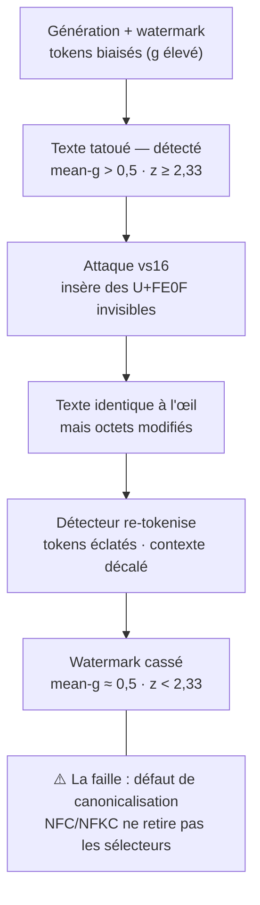

# canonicalization-bypass-lab

Note de sécurité éducative sur une **classe** de vulnérabilités : le *parser desync* (désaccord d'interprétation entre deux composants) et le défaut de **canonicalisation**.

Le fil conducteur : une attaque récente sur le *watermarking de texte* des LLM (insertion de caractères Unicode invisibles) est, au fond, **le même bug** que les bypass de WAF, les *path traversal* encodés ou le *HTTP request smuggling*. Comprendre le motif commun permet de les fermer tous de la même façon.

> ⚠️ **Cadre** — Contenu **éducatif et défensif**, basé sur de la recherche publique. L'objectif est de comprendre la *mécanique de la faille* et **comment s'en protéger**, pas de fournir un outil de contournement. Le code fourni est un **assainisseur côté défense**, pas une attaque clé en main.

---

## 1. Le cas d'étude : casser un watermark de texte

### Comment un LLM « tatoue » son texte (SynthID-Text)

À chaque token généré, une fonction pseudo-aléatoire `g()` — graine = `clé secrète + N tokens précédents` — attribue un score `g ∈ [0,1]` à chaque candidat. Un échantillonnage biaisé (« tournament sampling ») favorise les tokens à `g` élevé. Résultat : le texte généré a un `g` **moyen plus haut** que du texte normal, sans perte de qualité visible.

Le filigrane n'est donc **pas un caractère caché** : c'est un **biais statistique** réparti sur toute la suite de tokens.

### La détection

Le détecteur rejoue le calcul : il **re-tokenise** le texte, reconstruit le même contexte pour chaque token, recalcule `g()`, puis fait la moyenne (`mean-g`).

| Cas | `mean-g` | Verdict |
|---|---|---|
| Texte humain | ≈ 0,5 | non tatoué |
| Texte tatoué | > 0,5 | tatoué |

Test statistique : `z = (mean_g − 0,5) / (σ/√N)`. Si `z ≥ 2,33` (~99 %) → « tatoué ».

> 🔑 **Point critique** : la détection suppose de **retrouver exactement la même suite de tokens** qu'à la génération.

### La faille : désynchroniser la tokenisation (attaque « vs16 »)

Les **variation selectors** Unicode (`U+FE00`–`U+FE0F`, dont `U+FE0F`, + le bloc `U+E0100`–`U+E01EF`) sont des caractères **combinants invisibles**. En insérer après ~30 % des caractères ne change **rien à l'affichage**, mais change les **octets** → le tokenizer BPE produit une suite de tokens complètement différente → les `g` recalculés ne correspondent plus → `mean-g → 0,5` → `z` sous le seuil → « non tatoué ».

Le **gap** qui rend l'attaque possible : la normalisation Unicode standard (**NFC/NFKC**) **ne retire pas** les variation selectors (ce sont des code points valides). Un détecteur qui se contente de normaliser échoue donc.

---

## 2. Le même motif en sécurité web

À chaque fois : **deux composants interprètent la même entrée différemment**, et l'attaquant se glisse dans l'écart.

| Faille | Qui est en désaccord | L'écart exploité |
|---|---|---|
| vs16 (watermark) | détecteur vs tokenizer | Unicode invisible |
| Double-encodage URL | WAF vs application | nombre de décodages |
| Path traversal `..%c0%af` | filtre vs décodeur | UTF-8 « sur-long » |
| HTTP Request Smuggling | proxy vs backend | `Content-Length` vs `Transfer-Encoding` |
| Bypass d'auth Unicode | comparaison vs casefold | normalisation (`U+212A` → `k`, `ı` turc…) |

- **Double-encodage** : `%252e%252e%252f` → le WAF décode 1× (voit `%2e%2e%2f`, laisse passer), l'appli décode 2× (obtient `../`).
- **`..%c0%af`** : encodage UTF-8 illégal mais sur-long de `/`, accepté par un décodeur laxiste (faille historique IIS, CVE-2000-0884).
- **Smuggling** : le frontal et le backend ne s'accordent pas sur la frontière des requêtes → une requête est « cachée » dans une autre.
- **Auth Unicode** : un compte « presque admin » devient admin *après* normalisation (cas réels de détournement via homoglyphes).

---

## 3. Le correctif (côté défenseur)

Une seule règle d'or ferme **toute** cette famille :

> **Canonicalise d'ABORD, vérifie ENSUITE — et vérifie exactement sur la forme que le composant en aval utilisera.**

1. **Normalise avant de contrôler** — décode/normalise jusqu'à idempotence, puis applique le contrôle sur ce résultat. Jamais l'inverse.
2. **Un seul parseur, partagé** — le contrôle de sécurité et l'opération protégée doivent utiliser le **même** décodeur/tokenizer.
3. **Rejette l'ambigu** au lieu de le « réparer » silencieusement (encodage sur-long, double-encodage, caractères invisibles → `400 Bad Request`).
4. **Allowlist > denylist** — définis le licite, pas l'infinité des formes illicites.
5. **Canonicalisation idempotente** pour les comparaisons sensibles (NFKC + casefold une fois, stockée, réutilisée partout).

### Appliqué au watermark

- **Stripper** non-imprimables / zéro-largeur / variation selectors (`U+FE00`–`U+FE0F`, `U+E0100`–`U+E01EF`) **avant** la re-tokenisation — pas juste un NFC.
- **Détecter l'anomalie** elle-même : une densité anormale de sélecteurs = texte trafiqué → à flaguer (du texte humain n'en contient quasiment jamais).
- Re-tokeniser sur le texte **nettoyé** pour que la tokenisation recolle à celle de génération.

👉 Implémentation de référence (défensive) : [`defense/sanitize.py`](defense/sanitize.py).

---

## À retenir

> La plupart des bypass viennent d'un **désaccord d'interprétation** entre le contrôle et l'opération. On les ferme en **canonicalisant avant de vérifier**, avec **un seul parseur**.

## Références

- SynthID-Text (watermarking de texte génératif), Google DeepMind — *Nature*, 2024.
- OWASP — *Path Traversal*, *HTTP Request Smuggling*, *Unicode encoding bypass*.
- CVE-2000-0884 (IIS, décodage UTF-8 sur-long).

---

*Note rédigée dans un cadre d'apprentissage en cybersécurité. Aucune donnée réelle, aucun service tiers ciblé.*

## Licence

Distribué sous licence [MIT](LICENSE).
